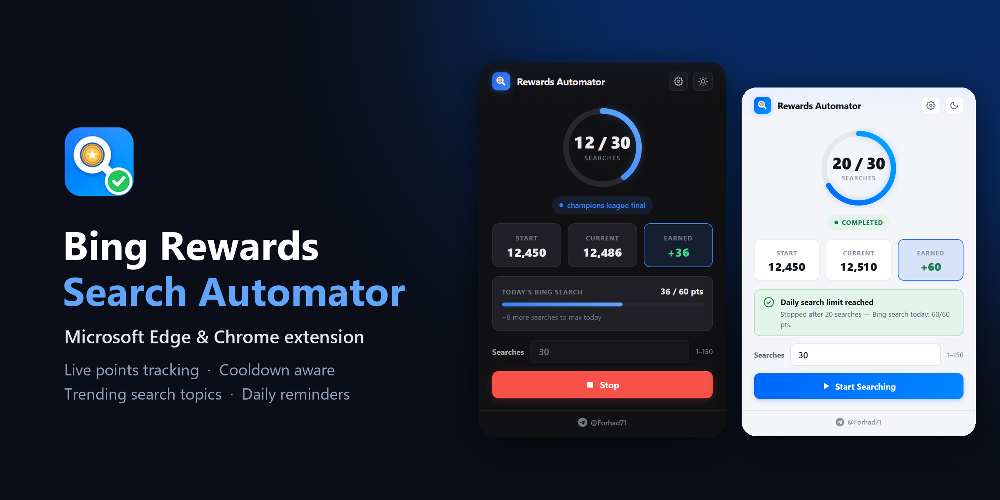
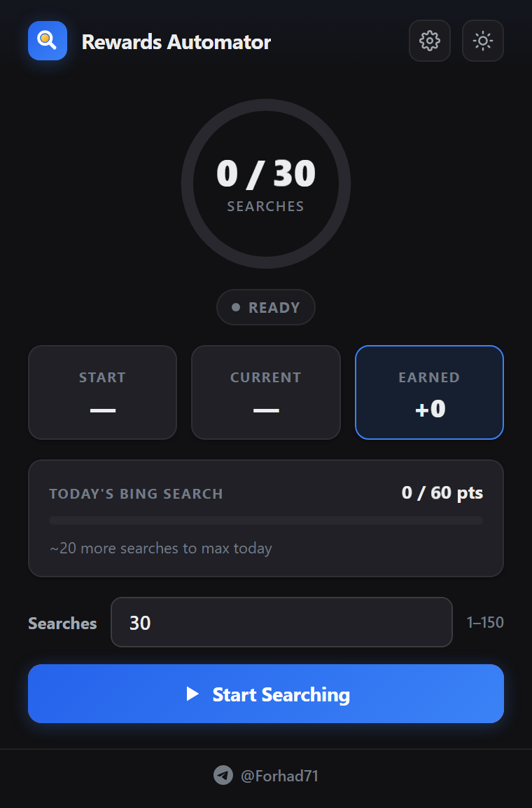
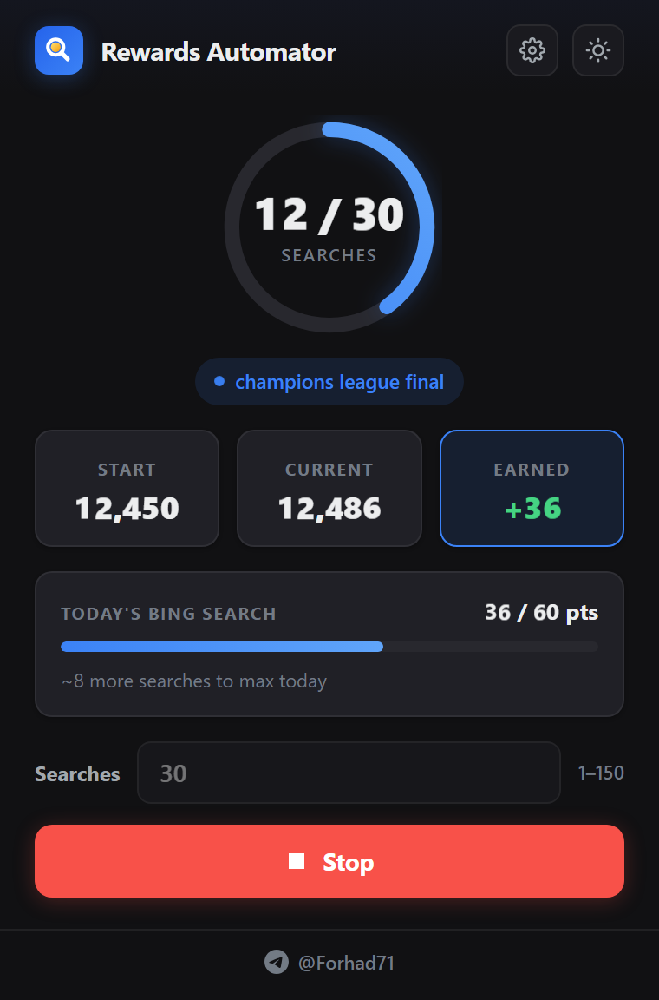
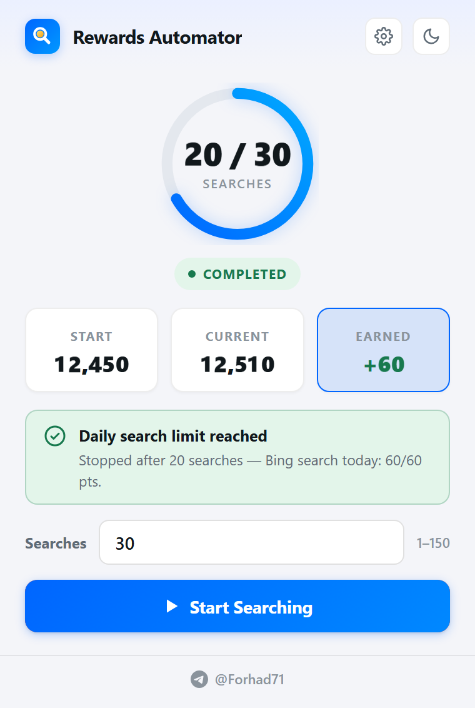
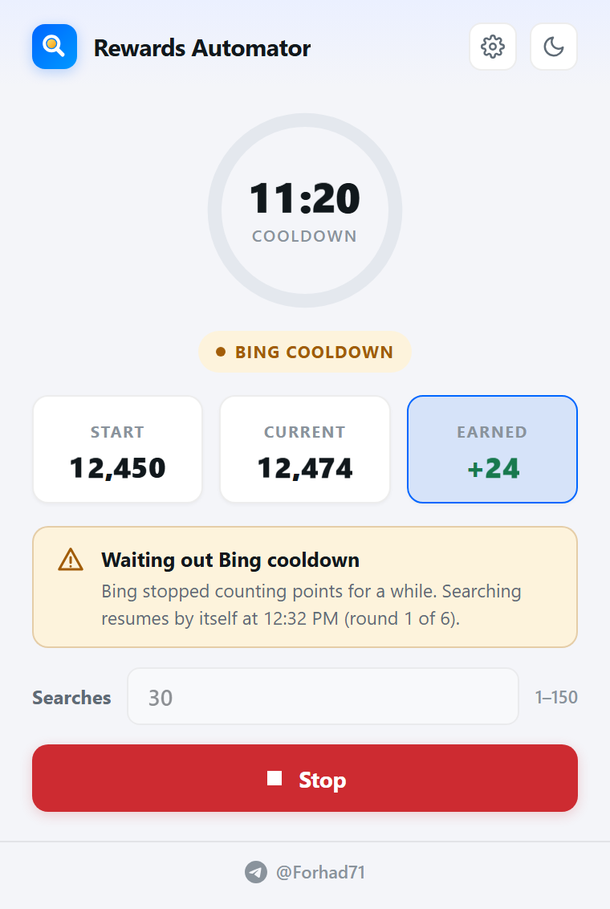
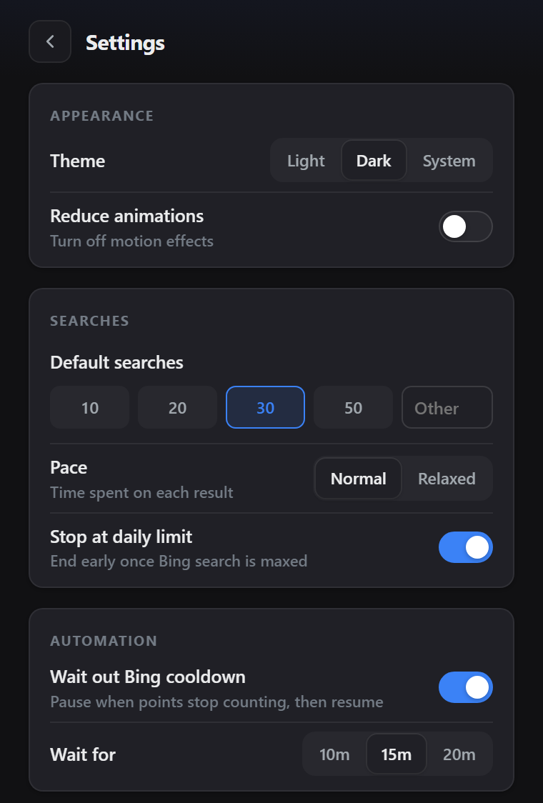
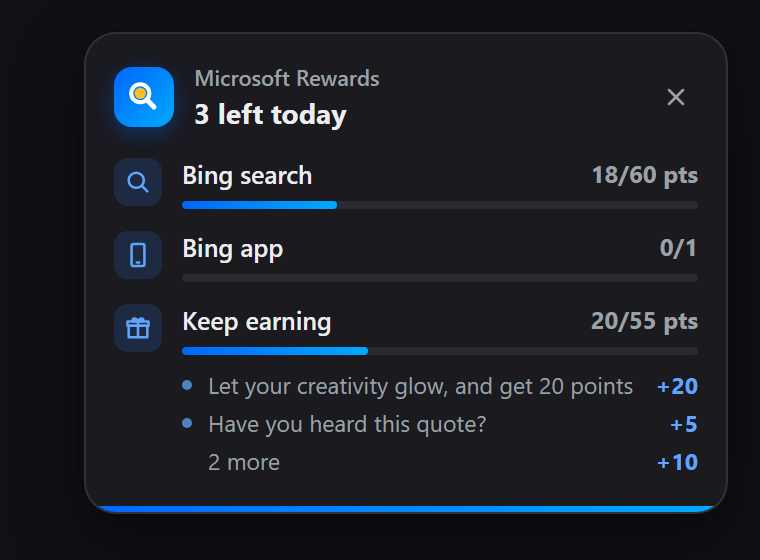
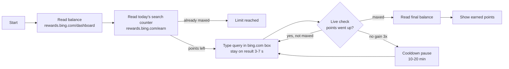

<div align="center">


# Bing Rewards Search Automator

**A Manifest V3 extension for Microsoft Edge and Google Chrome that runs your daily Bing searches, tracks the points you earn live, and stops when today's search limit is reached.**

[](https://github.com/ForhadHossain71/bing-rewards-search-automator/releases/latest)
[](https://developer.chrome.com/docs/extensions/develop/migrate/what-is-mv3)
[](#installation)
[](#installation)
[](LICENSE)



</div>

## Table of contents

- [Features](#features)
- [Screenshots](#screenshots)
- [Installation](#installation)
- [Usage](#usage)
- [Configuration](#configuration)
- [How it works](#how-it-works)
- [Permissions](#permissions)
- [Project structure](#project-structure)
- [Troubleshooting](#troubleshooting)
- [Roadmap](#roadmap)
- [Contributing](#contributing)
- [License](#license)
- [Author](#author)

## Features

| Feature | What it does |
| --- | --- |
| **Live points tracking** | Reads your balance from the Rewards dashboard before and after a run, and shows Start, Current and Earned while it searches. |
| **Daily limit check** | Reads today's Bing search counter (for example `36 / 60 pts`) first. If you are already maxed, it tells you and does not search. |
| **Auto-stop at the limit** | Ends the run as soon as Bing search is maxed for the day, so no searches are wasted. |
| **Real search box typing** | Types each query into the bing.com search box and submits it, then stays on the result page for a few seconds. |
| **Trending, non-repeating topics** | Builds queries from live Google Trends topics and Bing autocomplete. There is no fixed word list, and the same query is not reused within a day. |
| **Cooldown aware** | If Bing stops counting points for three searches in a row, it pauses for 10–20 minutes and then continues by itself. |
| **Background tabs** | Searches run in background tabs that close when the run ends. You can keep using the browser. |
| **Daily reminder card** | An optional card on the page you are viewing lists today's open tasks: Bing search, app tasks and unfinished "Keep earning" offers. |
| **Settings panel** | Default search count, pace, auto-stop, cooldown wait, reminder schedule, theme and reduced motion. |
| **Light and dark theme** | Follows your system theme or a choice you set, with smooth transitions and a reduced-motion option. |

## Screenshots

<table>
  <tr>
    <td align="center"><br><sub>Ready</sub></td>
    <td align="center"><br><sub>Searching, live points</sub></td>
    <td align="center"><br><sub>Done, limit reached</sub></td>
  </tr>
  <tr>
    <td align="center"><br><sub>Waiting out a cooldown</sub></td>
    <td align="center"><br><sub>Settings</sub></td>
    <td align="center"><br><sub>Daily reminder card</sub></td>
  </tr>
</table>

## Installation

The extension is not on the Edge Add-ons or Chrome Web Store yet, so you load it yourself. It takes about a minute.

1. **Download** the latest `bing-rewards-search-automator-vX.Y.Z.zip` from [Releases](https://github.com/ForhadHossain71/bing-rewards-search-automator/releases/latest) and unzip it.
   Or clone the repository:
   ```bash
   git clone https://github.com/ForhadHossain71/bing-rewards-search-automator.git
   ```
2. Open the extensions page:
   - Microsoft Edge: `edge://extensions`
   - Google Chrome: `chrome://extensions`
3. Turn on **Developer mode**.
4. Click **Load unpacked** and select the folder that contains `manifest.json`.
5. Pin the extension to the toolbar so the popup is one click away.

> Requires Edge or Chrome 110 or newer. You must be signed in to [rewards.bing.com](https://rewards.bing.com) in the same browser profile.

## Usage

1. Sign in to Microsoft Rewards at [rewards.bing.com](https://rewards.bing.com).
2. Open the extension popup and set the number of searches (1–150, default 30).
3. Press **Start Searching**. The extension:
   - reads your current balance,
   - checks today's Bing search progress,
   - runs searches in a background tab until the count is reached or the daily limit is maxed,
   - reads your balance again and shows what you earned.
4. Press **Stop** at any time. Points earned so far are still counted and shown.

Hover or focus the **Earned** card to see today's progress for every activity, including the unfinished "Keep earning" offers.

## Configuration

Open the gear icon in the popup. Settings are saved in the browser and apply to the next run.

| Setting | Options | Default | Notes |
| --- | --- | --- | --- |
| Theme | Light, Dark, System | System | Also toggled by the sun/moon button. |
| Reduce animations | On / Off | Off | Turns off motion effects. |
| Default searches | 10, 20, 30, 50, or any number 1–150 | 30 | Pre-fills the Searches box. |
| Pace | Normal, Relaxed | Normal | Time on each result: about 3–4 s (Normal) or 5–7.5 s (Relaxed). |
| Stop at daily limit | On / Off | On | Ends the run once Bing search is maxed. |
| Wait out Bing cooldown | On / Off | On | Pauses when points stop counting, then resumes (up to 6 times per run). |
| Wait for | 10, 15, 20 min | 15 min | Length of each cooldown pause. |
| Daily reminders | On / Off | Off | Needs the optional "all sites" permission to draw the card on pages. |
| Times per day | 1–5 | 3 | Maximum reminder cards per day. |
| Active hours | time range | 08:00–23:00 | Reminders only show inside this window. |
| Gap between | 1, 2, 4 h | 2 h | Minimum time between two reminders. |
| Show for | 5, 8, 12 s | 5 s | Hovering the card pauses its timer. |

There are no API keys or environment variables to set.

## How it works



- **Reading points.** The background service worker fetches the Rewards dashboard and Earn page with your existing browser session and reads the balance and the `pointsCounters` data from the page. If that fails, it opens the page in a background tab and reads it there.
- **Searching.** Each query is typed into the search box on bing.com and submitted. If that does not work, it opens the search results URL directly.
- **Queries.** Topics come from the Google Trends daily RSS feeds (US, GB, CA, AU, IN) and Bing's autocomplete suggestions. Used queries are remembered for a day so they are not repeated.
- **Cooldown.** After each search it rechecks the search counter. Three searches in a row without new points start a timed pause using `chrome.alarms`, so the pause survives the service worker sleeping.
- **Resilience.** Run state is stored in `chrome.storage.local`. A watchdog alarm resumes a run if the service worker restarts. A run cut off by closing the browser is not restarted on the next launch.

## Permissions

| Permission | Why it is needed |
| --- | --- |
| `tabs` | Open, update and close the background search and Rewards tabs. |
| `scripting` | Type into the Bing search box and read the Rewards page when a direct fetch is not enough. |
| `storage` | Save settings and the current run state. |
| `alarms` | Watchdog, cooldown timer and reminder schedule. |
| `https://*.bing.com/*`, `https://bing.com/*` | Bing search and the Rewards dashboard. |
| `https://trends.google.com/*` | Trending topics for search queries. |
| `<all_urls>` *(optional)* | Only requested if you turn on daily reminders, to show the card on the page you are viewing. |

The extension has no server and collects no analytics. See [PRIVACY.md](PRIVACY.md).

## Project structure

```text
bing-rewards-search-automator/
├── manifest.json        # MV3 manifest: permissions, popup, service worker
├── background.js        # Service worker: run flow, points readers, search loop,
│                        #   cooldown, query builder, reminder card
├── popup.html           # Popup and settings markup
├── popup.css            # Styles, light/dark tokens, animations
├── popup.js             # Popup logic: rendering, settings, start/stop
├── theme.js             # Applies the saved theme before first paint
├── icons/               # 16, 32, 48 and 128 px icons
├── docs/                # Banner and screenshots used in this README
└── .github/             # Issue/PR templates and the release workflow
```

## Troubleshooting

<details>
<summary><b>"Could not read your starting points"</b></summary>

- Make sure you are signed in at [rewards.bing.com](https://rewards.bing.com) in the same browser profile.
- Open the dashboard once in a normal tab and accept any prompts Microsoft shows.
- Click **Copy details** in the popup notice and include it if you open an issue.
</details>

<details>
<summary><b>Searches run but points do not go up</b></summary>

- Bing sometimes stops counting points for a while. With **Wait out Bing cooldown** on, the extension pauses and resumes by itself.
- If it still gives up after 6 pauses, try again later in the day or switch Pace to **Relaxed**.
- Check that today's counter is not already maxed: hover the **Earned** card.
</details>

<details>
<summary><b>The run stopped and says it was cut off</b></summary>

The browser was closed, or the PC went to sleep, in the middle of a run. The extension does not restart old runs by itself. Press **Start** to run again; searches already counted today are not lost.
</details>

<details>
<summary><b>The reminder card does not appear</b></summary>

- Turn on **Daily reminders** and choose **Allow** when the browser asks for site access.
- Reminders only show inside your active hours, respect the gap and daily limit, and skip days when everything is already done.
- Browser pages such as `edge://` or the new tab page cannot show the card. **Show a preview** opens a Bing tab and shows it there instead.
</details>

<details>
<summary><b>"Edge blocked page access"</b></summary>

Another extension or a browser policy is blocking script access to `bing.com`. On `edge://extensions`, open this extension's **Details** and make sure site access is allowed for `bing.com`.
</details>

## Roadmap

- [x] Live balance and daily search counter
- [x] Auto-stop at the daily limit
- [x] Trending, non-repeating search topics
- [x] Bing cooldown detection and auto-resume
- [x] Daily reminder card with "Keep earning" offers
- [x] Light and dark theme, reduced motion
- [ ] Publish on Microsoft Edge Add-ons and the Chrome Web Store
- [ ] Run history with points per day
- [ ] Firefox (MV3) build
- [ ] Translations

Have an idea? [Open a feature request](https://github.com/ForhadHossain71/bing-rewards-search-automator/issues/new?template=feature_request.yml).

## Contributing

Bug reports, ideas and pull requests are welcome. Read [CONTRIBUTING.md](CONTRIBUTING.md) to get started, and [SECURITY.md](SECURITY.md) for reporting security issues privately.

## Disclaimer

This project is not affiliated with, endorsed by, or sponsored by Microsoft. "Microsoft Rewards" and "Bing" are trademarks of Microsoft Corporation. Automating searches may conflict with the Microsoft Rewards terms; you are responsible for how you use this extension.

## License

Released under the [MIT License](LICENSE). Copyright (c) 2026 Forhad Hossain.

## Author

**Forhad Hossain**

- Telegram: [@Forhad71](https://t.me/Forhad71)
- GitHub: [@ForhadHossain71](https://github.com/ForhadHossain71)

---

<div align="center">

If this extension saves you time, please give it a ⭐ on GitHub.

</div>
